# 1. Qué es EcoRuta y para quién es

EcoRuta es la aplicación web interna de EcoEnvíos S. A. para registrar solicitudes de envío, cotizarlas con criterios ecológicos, armar rutas de despacho, controlar la bodega y revisar indicadores ambientales. Reemplaza las hojas de cálculo manuales y resuelve cuatro problemas: guías duplicadas, falta de visibilidad del inventario, tarifas inconsistentes entre agentes y ausencia de indicadores ambientales.

La aplicación no pide usuario ni contraseña. Los tres perfiles de trabajo se atienden con la organización de las vistas:

| Perfil | Qué necesita | Vistas que usa |
| --- | --- | --- |
| Agente de servicio | Registrar solicitudes rápido y sin errores, y cotizar frente al cliente | Clientes, Registro, Seguimiento |
| Encargado de bodega | Saber qué hay almacenado y cambiar el estado de los paquetes | Inventario, Seguimiento |
| Supervisor de operaciones | Armar rutas, consolidar envíos y revisar indicadores | Despacho, Panel, Catálogo |

**Contenido de este manual**

1. Qué es EcoRuta y para quién es
2. Antes de empezar: abrir la aplicación y conocer la pantalla
3. El recorrido completo de un envío (ruta rápida)
4. Panel de sostenibilidad
5. Clientes
6. Registro de solicitudes y comparación de modalidades
7. Catálogo institucional
8. Inventario del centro de distribución
9. Despacho y consolidación de rutas
10. Seguimiento y trazabilidad
11. Configuración, respaldo y datos de demostración
12. Cómo se calculan las tarifas, el descuento ecológico y las emisiones
13. Impresión
14. Mensajes frecuentes y qué hacer
15. Preguntas frecuentes
16. Glosario

# 2. Antes de empezar

## 2.1 Abrir la aplicación

1. Abra la carpeta del proyecto en Visual Studio Code.
2. Inicie la extensión **Live Server** (clic derecho sobre `index.html` → *Open with Live Server*). Sirve cualquier servidor HTTP local, por ejemplo `python3 -m http.server`.
3. No abra `index.html` con doble clic (`file://`): el catálogo `datos/datos.json` se descarga con `fetch` y los módulos exigen HTTP.
4. La primera pantalla dice «Cargando catálogo institucional…». Si falla, aparece un mensaje de error y el botón **Reintentar**; si ya había una copia del catálogo guardada, la aplicación sigue con ella aunque no haya red.

Para practicar con datos de ejemplo, vaya a **Configuración → Cargar datos de demostración** (15 clientes, 43 envíos en todos los estados y 5 rutas). Los ejemplos de este manual usan esos datos.

## 2.2 La pantalla

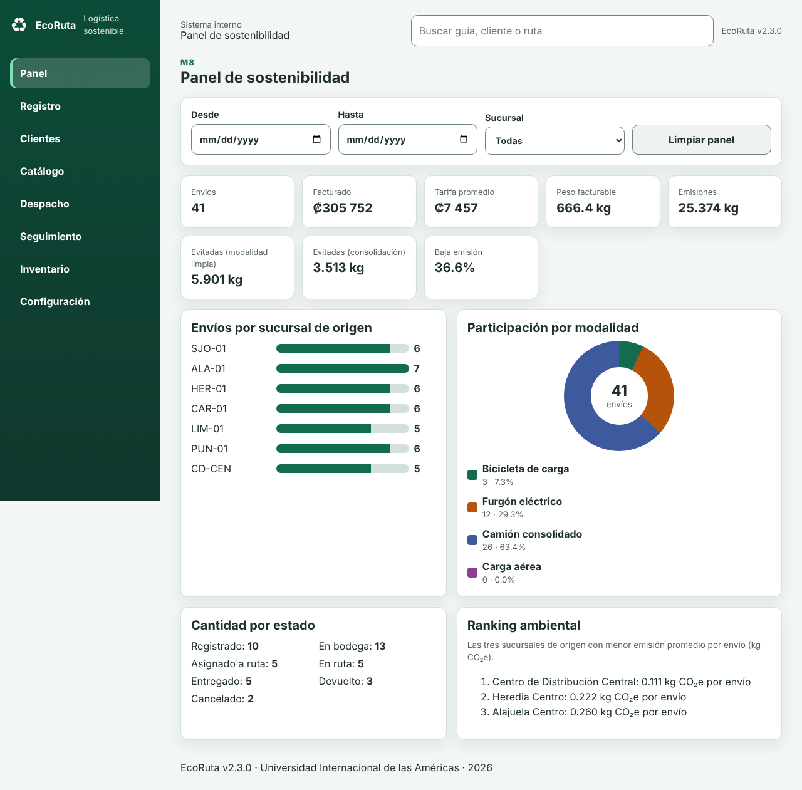{ width=16cm }

- **Menú lateral**: ocho vistas (Panel, Registro, Clientes, Catálogo, Despacho, Seguimiento, Inventario, Configuración). En pantallas angostas se abre con el botón ☰.
- **Barra superior**: nombre de la vista actual y la **búsqueda global**.
- **Avisos**: los mensajes de éxito y de error aparecen como avisos temporales; los errores de un campo aparecen debajo del propio campo.
- **Confirmaciones**: las acciones que no se pueden deshacer piden confirmación en una ventana.

La aplicación recuerda la última vista que usó y el tema elegido.

## 2.3 Búsqueda global

Escriba en el cuadro **Buscar guía, cliente o ruta** (por ejemplo `ENV-2026-0000`, el nombre de un cliente o `RUTA-2026-0003`). Aparece una lista de coincidencias; **Enter** abre la primera, las **flechas** recorren la lista y el ratón también sirve. La aplicación abre la vista correspondiente. **Esc** cierra la lista.

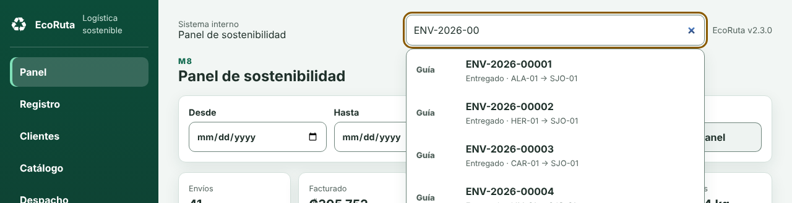{ width=16cm }

## 2.4 Los estados de un envío

Todo envío pasa por estados definidos; no se puede saltar de uno a otro de cualquier manera.

| Estado | Significa | Pasa a |
| --- | --- | --- |
| Registrado | La solicitud existe, el paquete aún no llegó físicamente | En bodega, Devuelto |
| En bodega | El paquete fue recibido y está almacenado | Asignado a ruta (al asignarlo), Devuelto |
| Asignado a ruta | Está reservado en una ruta abierta | En bodega (si se retira), En ruta (al despachar la ruta) |
| En ruta | La ruta salió | Entregado, Devuelto |
| Entregado | Llegó a su destino (estado final) | — |
| Devuelto | Regresó o no pudo entregarse (estado final; admite un reenvío) | — |
| Cancelado | Baja lógica de la solicitud: la guía y el historial se conservan | — |

Un envío **en ruta o entregado no se puede editar ni cancelar**. Toda cancelación exige un motivo de al menos 10 caracteres y conserva la guía para auditoría: el número de guía **nunca se reutiliza**.

# 3. El recorrido completo de un envío (ruta rápida)

1. **Clientes**: verifique que el remitente y el destinatario existan; si no, créelos (sección 5).
2. **Registro**: complete la solicitud y pulse **Comparar modalidades** (sección 6).
3. Elija la modalidad con **Elegir y registrar**. El envío queda *Registrado* y recibe su guía `ENV-AAAA-NNNNN`.
4. **Inventario**: cuando el paquete llegue físicamente, en *Pendientes de ingreso a bodega* pulse **Ingresar a bodega**. Queda *En bodega* (sección 8).
5. **Despacho**: cree una ruta con el mismo destino y la misma modalidad del envío y asígnelo con **Asignar** (sección 9).
6. Revise el **ahorro por consolidación** de la ruta y pulse **Cerrar y despachar**. Los envíos pasan en bloque a *En ruta*.
7. **Seguimiento**: busque la guía y use **Cambiar a Entregado** (o **Cambiar a Devuelto**) cuando corresponda (sección 10).
8. **Panel**: revise los indicadores ambientales (sección 4).

# 4. Panel de sostenibilidad

El Panel resume la operación y el efecto ambiental. Los indicadores se calculan sobre los envíos vigentes (los cancelados no cuentan).

**Filtros**: *Desde* y *Hasta* (fecha de registro del envío) y *Sucursal* (envíos que salen de ella o llegan a ella). El botón **Limpiar panel** los restablece. Si la fecha «Hasta» es anterior a «Desde», la aplicación lo indica en lugar de mostrar datos incorrectos.

**Indicadores**

| Indicador | Qué muestra |
| --- | --- |
| Envíos | Cantidad de envíos vigentes en el filtro |
| Facturado | Suma de los totales cobrados |
| Tarifa promedio | Facturado ÷ envíos |
| Peso facturable | Kilogramos facturables acumulados |
| Emisiones | kg CO₂e estimados de todos los envíos |
| Evitadas (modalidad limpia) | kg CO₂e que se evitaron al usar bicicleta o furgón eléctrico frente al camión de combustión de referencia |
| Evitadas (consolidación) | kg CO₂e que se evitaron al consolidar rutas despachadas (ver sección 9.5) |
| Baja emisión | Porcentaje de los envíos vigentes que usan una modalidad de baja emisión (bicicleta o furgón eléctrico) |

**Gráficos y ranking**: envíos por sucursal de origen, participación por modalidad, cantidad por estado y el *ranking ambiental* con las tres sucursales de menor emisión promedio por envío.

# 5. Clientes

Aquí se registran las personas que envían o reciben paquetes. Un cliente debe existir antes de usarse en una solicitud.

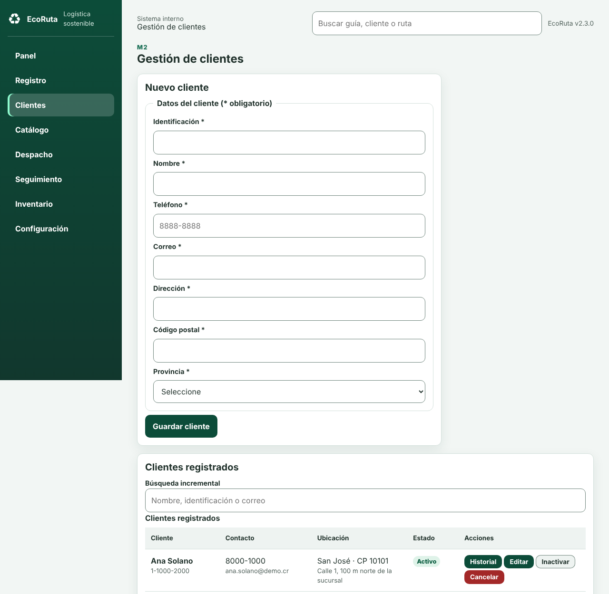{ width=16cm }

## 5.1 Crear un cliente

Complete los siete campos obligatorios (marcados con *): **Identificación, Nombre, Teléfono, Correo, Dirección, Código postal y Provincia**, y pulse **Guardar cliente**.

- Los errores aparecen **solo después de que usted interactúa con el campo** (o intenta guardar) y dicen exactamente qué corregir.
- El **teléfono** se formatea solo: al escribir `61681217` se convierte en `6168-1217` (también si lo pega).
- El **código postal** son 5 dígitos.
- La **identificación** y el **correo** no pueden repetirse (el correo no distingue mayúsculas).
- Los espacios al inicio y al final se eliminan automáticamente.

## 5.2 Buscar, editar, inactivar, historial y cancelar

- **Búsqueda incremental**: el listado se filtra mientras escribe, sin recargar la página.
- **Editar**: carga el cliente en el formulario (el título cambia y aparece **Cancelar edición**).
- **Inactivar / Activar**: un cliente inactivo no aparece al registrar solicitudes nuevas, pero conserva sus datos.
- **Historial**: abre una ventana con todos los envíos de ese cliente.
- **Cancelar**: baja lógica con motivo obligatorio. **No se puede cancelar un cliente con envíos activos**; en ese caso la aplicación lista las guías y le pide **inactivarlo**. Los clientes cancelados no se editan.

# 6. Registro de solicitudes y comparación de modalidades

Es la vista del agente de servicio. Se divide en el formulario, la comparación y la tabla de solicitudes registradas.

## 6.1 Completar la solicitud

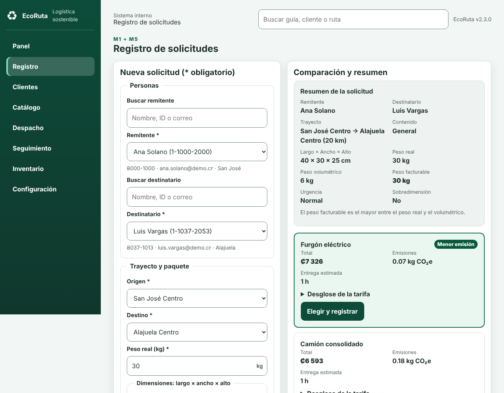{ width=16cm }

1. **Personas**: elija remitente y destinatario. Puede escribir en *Buscar remitente / destinatario* para acortar la lista. Deben ser clientes diferentes.
2. **Trayecto**: sucursal de **origen** y de **destino** (distintas). La distancia sale de la matriz del catálogo; usted no la escribe.
3. **Peso real** en kg (entre 0,1 y 500 kg).
4. **Dimensiones** largo × ancho × alto en cm (enteros, mínimo 1 cm).
5. **Contenido**: General, Frágil o Cadena de frío.
6. **Urgente** (opcional): añade un recargo.
7. **Sobredimensión autorizada**: solo si alguna dimensión supera **200 cm**. Marque la casilla e indique el **responsable** que la autorizó (obligatorio; los espacios sobrantes se descartan). Añade un recargo y queda registrado en el envío, el detalle, el seguimiento y el historial. Ninguna dimensión puede superar 300 cm.

El sistema calcula el **peso volumétrico** (largo × ancho × alto ÷ 5 000) y cobra el **peso facturable**, que es el mayor entre el peso real y el volumétrico.

## 6.2 Comparar modalidades

Pulse **Comparar modalidades**. A la derecha aparece:

- El **resumen de la solicitud** (personas, trayecto, medidas, pesos, urgencia, sobredimensión).
- Una tarjeta por cada **modalidad viable**, con el **total a cobrar**, las **emisiones** (kg CO₂e) y la **entrega estimada**. La de menor emisión se destaca con la etiqueta **Menor emisión**.
- Dentro de cada tarjeta, el **Desglose de la tarifa**.

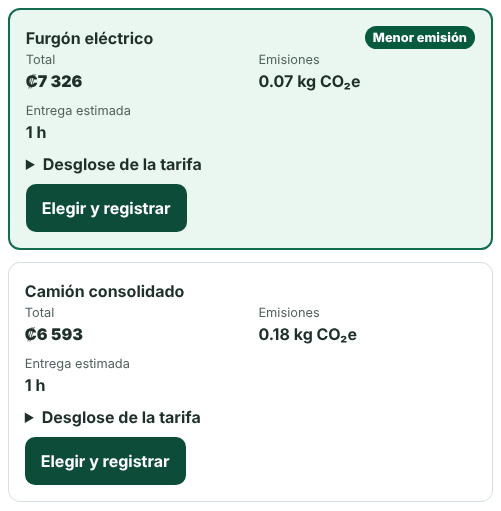{ width=8cm }

Una modalidad es viable si cumple el peso, la distancia, la sucursal de origen y las reglas de cada vehículo (la bicicleta admite hasta 25 kg y 30 km; la carga aérea exige al menos 120 km; la cadena de frío solo admite modalidades refrigeradas). Si ninguna cumple, la aplicación lo explica en lugar de mostrar tarjetas vacías.

### El desglose de la tarifa

Abra **Desglose de la tarifa** para ver cada componente con su regla y su monto: *Base, Peso facturable, Distancia, Ajuste por modalidad, Subtotal, Recargos (urgente, frágil, frío, sobredimensión), Descuento ecológico y Total*. Dos agentes que cotizan el mismo envío obtienen siempre el mismo valor.

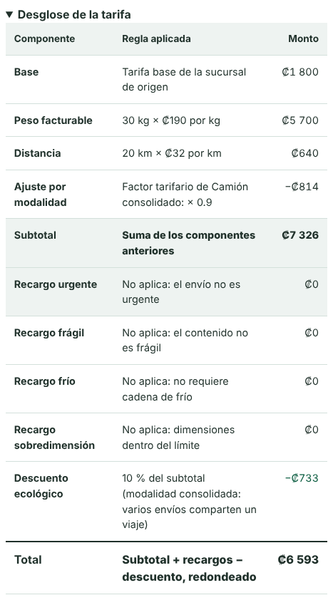{ width=8cm }

Fíjese en la fila **Descuento ecológico**: dice por qué se aplicó («modalidad de baja emisión» o «modalidad consolidada: varios envíos comparten un viaje») o por qué no («no se acumula con el recargo por urgencia» o «la modalidad no es de baja emisión ni consolidada»). Más detalle en la sección 12.

> **Importante.** Si cambia cualquier dato del formulario después de comparar, las opciones se limpian con el mensaje «Los datos cambiaron. Vuelva a comparar las modalidades.» Así nunca se registra una tarifa calculada con datos distintos a los que se ven.

## 6.3 Registrar el envío

Pulse **Elegir y registrar** en la modalidad deseada. La aplicación revisa todas las reglas a la vez (cada error indica el campo y qué hacer), asigna la guía `ENV-AAAA-NNNNN` y muestra el aviso «Envío ENV-… registrado». Se guarda también cuál era la modalidad de menor emisión y si usted la eligió.

> **Para consolidar rutas** (sección 9), registre los envíos con la modalidad **Camión consolidado**: una ruta solo acepta envíos de su mismo destino y de su misma modalidad.

## 6.4 Tabla de solicitudes registradas

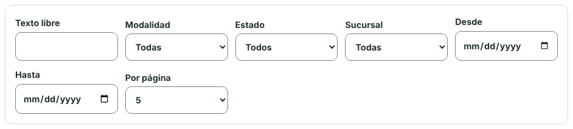{ width=14cm }

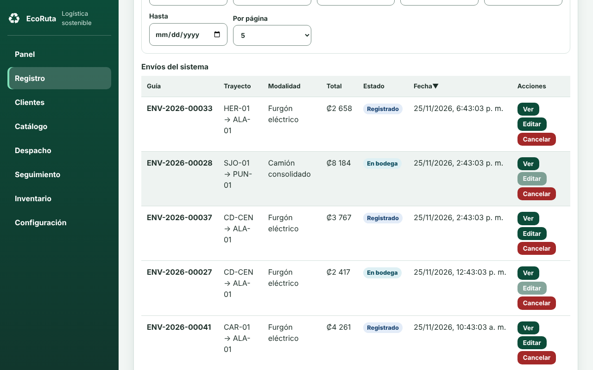{ width=16cm }

- **Contadores**: Activos, Cancelados, Históricos y Total general.
- **Filtros**: texto libre (guía, cliente), modalidad, estado, sucursal, rango de fechas *Desde/Hasta* y *Por página* (5, 10 o 20). **Limpiar filtros** los restablece.
- **Orden**: pulse el encabezado de una columna (Guía, Trayecto, Modalidad, Total, Estado, Fecha); vuelva a pulsarlo para invertir el orden.
- **Paginación**: *Anterior* y *Siguiente*.
- **Acciones por fila**:
  - **Ver**: abre el detalle del envío.
  - **Editar**: solo si el envío está *Registrado*. Carga los datos en el formulario; vuelva a comparar y pulse **Guardar corrección**. La guía no cambia.
  - **Cancelar**: baja lógica con motivo (no disponible para envíos en ruta o entregados).
  - **Reenviar**: solo para envíos *Devueltos*. Copia los datos al formulario («Datos copiados. Revise y compare las modalidades.») y crea una solicitud nueva enlazada con la original. Un envío devuelto admite **un solo reenvío activo**.

Al registrar o cancelar, solo se inserta o reemplaza la fila afectada; la tabla no se redibuja completa.

## 6.5 Detalle del envío

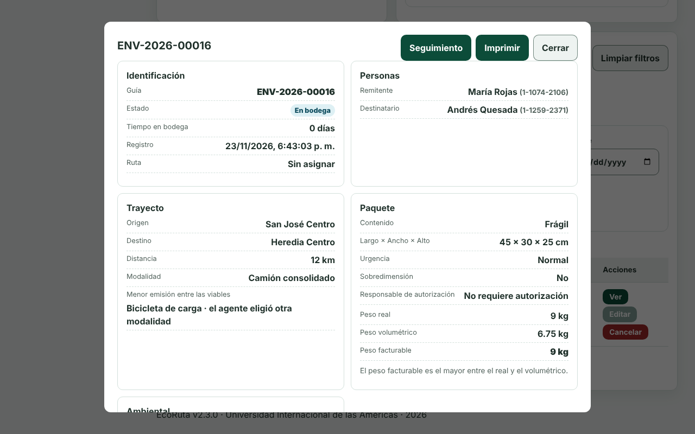{ width=16cm }

El detalle muestra las personas, el trayecto, los tres pesos (real, volumétrico y facturable), las dimensiones, la tarifa desglosada, la sección **Ambiental** (emisiones estimadas y evitadas), el estado y el historial. Desde aquí puede ir a **Seguimiento** o **Imprimir** la ficha.

## 6.6 Cancelar un envío

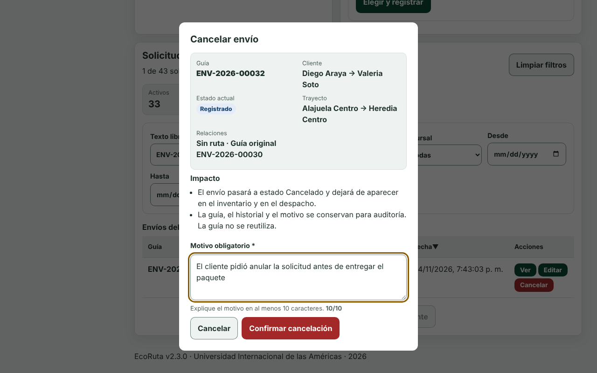{ width=16cm }

La ventana de cancelación muestra un resumen del envío y el **impacto** de la acción. Escriba el **motivo** (el contador indica cuántos caracteres faltan para llegar a 10); **Confirmar cancelación** se habilita al cumplirlo. **Esc** o **Cancelar** cierran la ventana sin cambios. La guía y el historial se conservan.

# 7. Catálogo institucional

Vista de solo lectura con los datos que gobiernan los cálculos: sucursales (capacidad y tarifa base), modalidades (capacidad, velocidad, factor de emisión, factor tarifario), tarifas, recargos y reglas del paquete. **Nada de esto está incrustado en el código**: sale del archivo `datos/datos.json`, que es la única fuente.

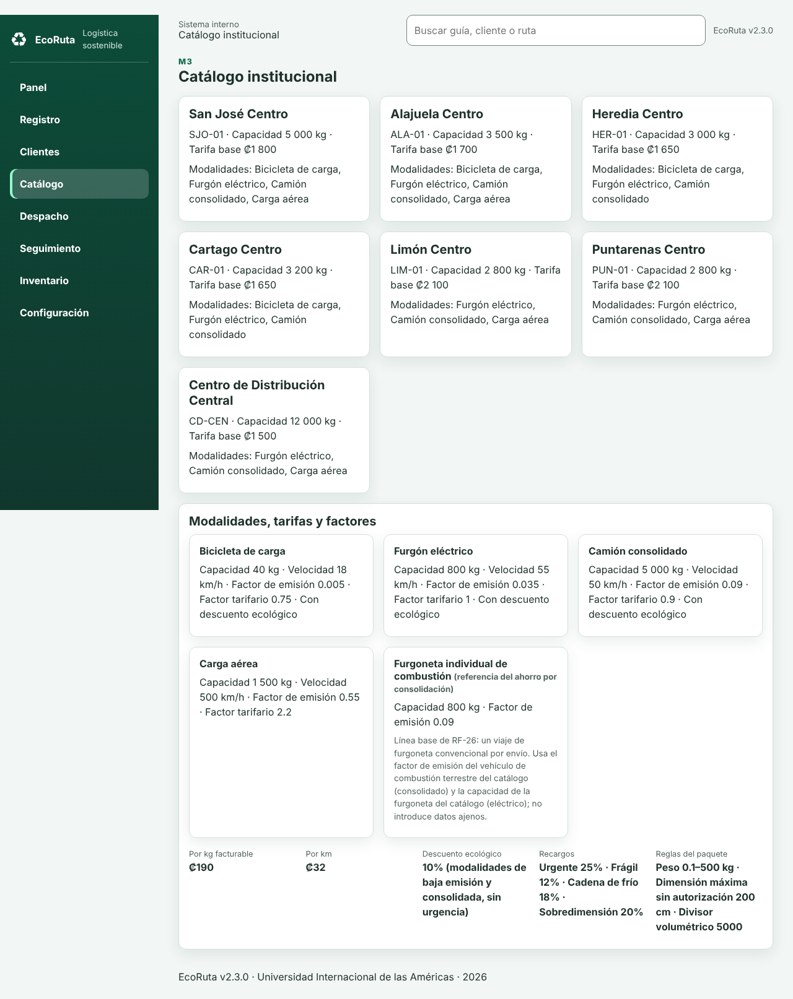{ width=16cm }

Tres detalles útiles:

- Las modalidades que reciben descuento ecológico llevan la marca **Con descuento ecológico** (bicicleta, furgón eléctrico y camión consolidado).
- La tarjeta **Furgoneta individual (referencia del ahorro por consolidación)** muestra la línea base que se usa para calcular el ahorro de las rutas (sección 9.5).
- La tarjeta de tarifas indica que el descuento aplica a *modalidades de baja emisión y consolidada, sin urgencia*.

# 8. Inventario del centro de distribución

Es la vista del encargado de bodega.

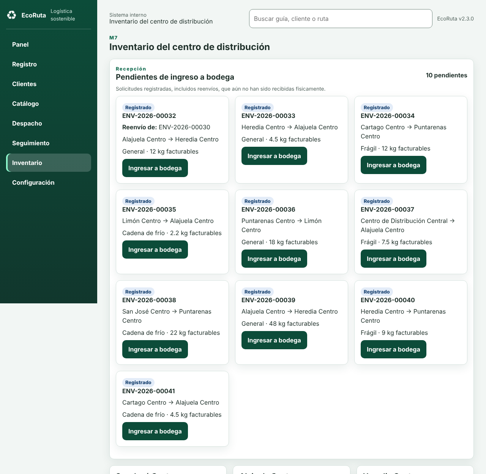{ width=16cm }

1. **Pendientes de ingreso a bodega**: solicitudes *Registradas* (incluidos los reenvíos) cuyo paquete aún no llegó. Cuando lo reciba físicamente pulse **Ingresar a bodega** y confirme. El envío pasa a *En bodega* y empieza a contar su tiempo de almacenamiento.
2. **Ocupación por sucursal**: peso, cantidad de paquetes y porcentaje de ocupación. Si una sucursal alcanza el **umbral de ocupación** (configurable) se resalta y aparece una **Alerta**.
3. **Paquetes en inventario**: tabla ordenada por antigüedad, con filtros de sucursal y estado (*Todos, En bodega, Asignado a ruta, En ruta, Retenido*).
4. **Retenidos**: un paquete *en bodega* que supera los **días máximos** (3 por defecto; 1 para cadena de frío) se marca como **Retenido** y la fila se resalta en naranja. «Retenido» no es un estado que usted cambie: se calcula solo.
5. **Distribución por contenido y por destino**: dos resúmenes para planificar rutas.

# 9. Despacho y consolidación de rutas

Es la vista del supervisor de operaciones. Aquí se agrupan envíos en una ruta, se mide el ahorro ambiental y se despacha.

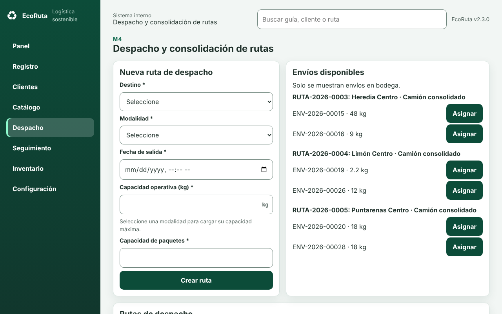{ width=16cm }

## 9.1 Crear una ruta

Complete **Destino, Modalidad, Fecha de salida, Capacidad operativa (kg) y Capacidad de paquetes**, y pulse **Crear ruta**.

- Al elegir la modalidad, el campo de capacidad muestra su **máximo** (bicicleta 40 kg, furgón eléctrico 800 kg, camión consolidado 5 000 kg, carga aérea 1 500 kg). La capacidad operativa no puede superarlo.
- La **fecha de salida** debe ser futura.
- La ruta recibe un código `RUTA-AAAA-NNNN` y queda **Abierta**.

## 9.2 Asignar y retirar envíos

En **Envíos disponibles** aparecen, por cada ruta abierta, solo los envíos **en bodega con el mismo destino y la misma modalidad**. Pulse **Asignar** junto a la guía. La aplicación controla la **capacidad en peso y en cantidad de paquetes**; si no cabe, le dice cuánto espacio libre queda. Cada tarjeta muestra el peso facturable, los paquetes, el espacio libre y una barra de ocupación.

Mientras la ruta esté abierta, **Retirar** devuelve el envío a *En bodega*. Una ruta que ya salió no admite cambios.

## 9.3 La tarjeta de la ruta

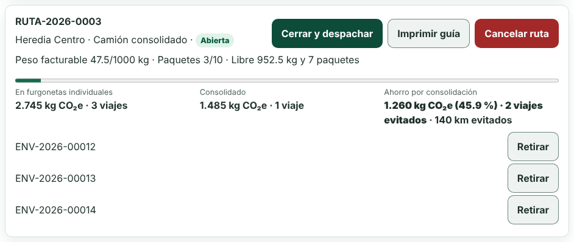{ width=16cm }

Además del estado y la carga, cada ruta muestra tres datos ambientales:

| Dato | Qué significa |
| --- | --- |
| **En furgonetas individuales** | Emisiones y viajes si cada envío saliera solo en su propia furgoneta |
| **Consolidado** | Emisiones y viajes de un solo viaje que lleva todos los envíos |
| **Ahorro por consolidación** | La diferencia, en kg CO₂e y en %, más los **viajes** y **km evitados** |

## 9.4 Cerrar y despachar

Pulse **Cerrar y despachar** (se habilita con al menos un envío). La ventana de confirmación resume la ruta y compara las emisiones consolidadas con las de las furgonetas individuales.

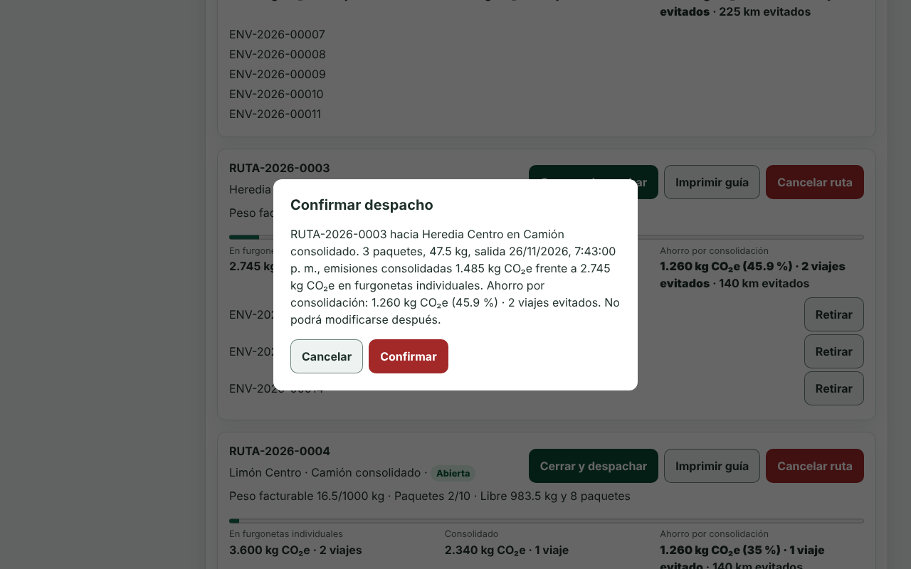{ width=16cm }

Al confirmar:

- Todos los envíos de la ruta pasan **en bloque** a *En ruta*, con su fecha y hora en el historial.
- La ruta queda *En ruta* y **ya no puede modificarse**.
- El resultado de la consolidación se **guarda** en la ruta, de modo que sigue mostrándose igual aunque el catálogo cambie.
- El ahorro se reparte en partes iguales entre los envíos y alimenta el indicador *Evitadas (consolidación)* del Panel.

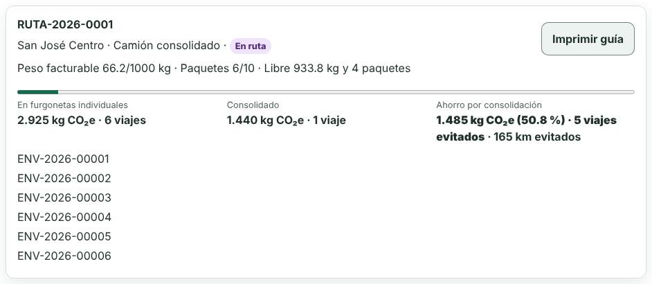{ width=16cm }

**Imprimir guía** genera la guía de despacho (A4) con los envíos, las emisiones y el ahorro; tiene espacio para las firmas de quien despachó y quien recibió. **Cancelar ruta** (solo si no ha salido) pide un motivo y devuelve todos sus envíos a *En bodega*.

## 9.5 Cómo se calcula el ahorro por consolidación

La comparación es entre dos formas de mover los mismos paquetes:

- **Sin consolidar**: una furgoneta individual por envío (un viaje por paquete).
- **Consolidado**: un solo viaje de la modalidad de la ruta con todos los envíos.

Consolidar ahorra emisiones **también con vehículos de combustión**: se evitan viajes y kilómetros. La furgoneta de referencia está declarada en el catálogo y se explica en `docs/POLITICA_ECOLOGICA.md`.

**Ejemplo real de la demostración (RUTA-2026-0003, tres envíos a Heredia):** en furgonetas individuales 2,745 kg CO₂e (3 viajes); consolidado 1,485 kg CO₂e (1 viaje). Ahorro: **1,260 kg CO₂e (45,9 %)**, 2 viajes y 140 km evitados; cada envío se anota 0,420 kg CO₂e evitados.

# 10. Seguimiento y trazabilidad

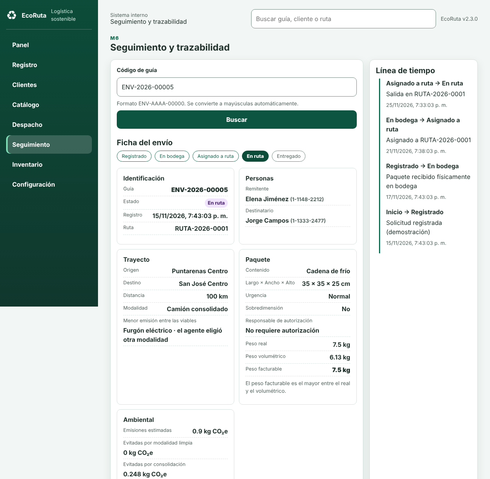{ width=16cm }

1. Escriba la **guía** en el formato `ENV-AAAA-00000`. Se convierte a mayúsculas y se acomoda sola (por ejemplo, `env202600003` pasa a `ENV-2026-00003`). Si el formato no es válido, un mensaje debajo del campo lo explica.
2. Pulse **Buscar**. Aparece la **ficha del envío** (personas, trayecto, pesos, dimensiones, tarifa desglosada, ambiente, sobredimensión autorizada si existe) y la **línea de tiempo** con cada cambio de estado, su fecha, su hora y el estado anterior.
3. Debajo de la ficha hay un botón por cada **transición permitida** (por ejemplo, *Cambiar a Entregado* para un envío en ruta). Confirme la acción; los cambios no válidos se rechazan.

Un envío cancelado conserva su ficha con el motivo; un reenvío enlaza con la guía original y viceversa.

# 11. Configuración, respaldo y datos de demostración

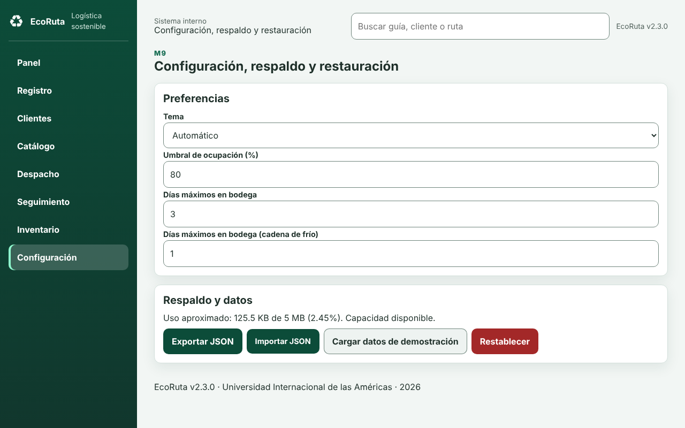{ width=16cm }

**Preferencias**

| Opción | Detalle |
| --- | --- |
| Tema | *Automático* sigue al sistema (claro u oscuro); *Claro* y *Oscuro* lo fijan. La elección se recuerda. |
| Umbral de ocupación (%) | Entero entre 50 y 100; activa la alerta del Inventario. |
| Días máximos en bodega | Entero entre 1 y 30; a partir de allí un paquete es *Retenido*. |
| Días máximos en bodega (cadena de frío) | Entero entre 1 y 30; plazo especial para cadena de frío. |

Si escribe un valor fuera de rango, la aplicación conserva el anterior y explica el límite.

**Respaldo y datos**

- **Exportar JSON**: descarga un respaldo completo (clientes, envíos, rutas y configuración).
- **Importar JSON**: restaura un respaldo. La aplicación **lo valida** antes de usarlo y avisa si está dañado; luego pide confirmar porque **reemplaza todos los datos actuales**.
- **Cargar datos de demostración**: reemplaza los datos por un conjunto de ejemplo coherente. Pide confirmación.
- **Restablecer**: borra todos los datos. Exige **dos confirmaciones** porque es irreversible.
- Un texto indica cuánto espacio de almacenamiento usan los datos.

Los datos se guardan en el navegador (`localStorage`, clave `ecoruta_estado_v5`). Si cambia de navegador o de equipo, use un respaldo.

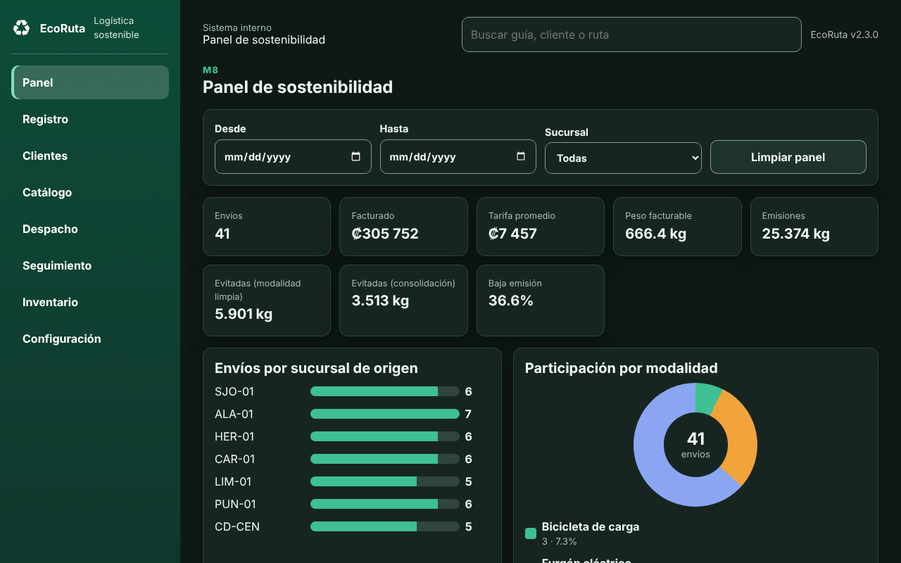{ width=14cm }

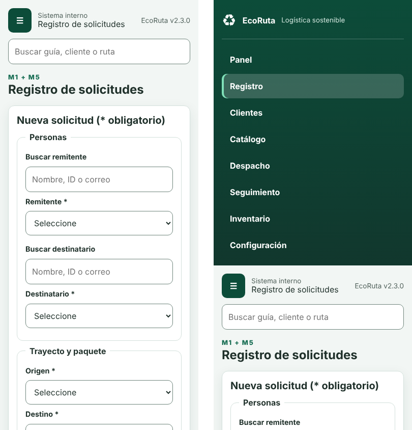{ width=11cm }

# 12. Cómo se calculan las tarifas, el descuento ecológico y las emisiones

## 12.1 Tarifa

```text
subtotal = (base de la sucursal de origen
            + peso facturable × tarifa por kg
            + distancia × tarifa por km) × factor tarifario de la modalidad
total    = subtotal + recargos − descuento ecológico   (redondeado)
```

Tarifas del catálogo: ₡190 por kg y ₡32 por km. Recargos sobre el subtotal: **urgente 25 %, frágil 12 %, cadena de frío 18 %, sobredimensión 20 %**.

## 12.2 Descuento ecológico

El descuento es de **10 % del subtotal** y lo reciben:

- las modalidades de **baja emisión**: bicicleta de carga y furgón eléctrico;
- la modalidad **consolidada**: camión consolidado, porque consolidar reduce viajes y emisiones por paquete aun con vehículos de combustión.

**No se acumula con la urgencia**: un envío urgente paga el recargo y no recibe descuento, sea cual sea su modalidad. La carga aérea no recibe descuento.

**Ejemplo** (San José Centro → Alajuela Centro, 20 km, 30 kg, contenido general):

| Modalidad | Subtotal | Descuento | Total |
| --- | --- | --- | --- |
| Furgón eléctrico (baja emisión) | ₡8 140 | −₡814 | **₡7 326** |
| Camión consolidado | ₡7 326 | −₡733 | **₡6 593** |
| Camión consolidado, **urgente** | ₡7 326 (+ recargo ₡1 832) | ₡0 | **₡9 158** |

## 12.3 Emisiones

```text
kg CO₂e = kilómetros × factor de emisión de la modalidad × proporción de la capacidad usada
```

La proporción de capacidad no baja de 10 %: un vehículo casi vacío igual emite. En el ejemplo anterior, el furgón eléctrico emite 0,07 kg CO₂e y el camión consolidado, 0,18 kg CO₂e.

Las emisiones son **estimaciones**: usan un factor por modalidad y no consideran tráfico, carga de retorno ni consumo real.

# 13. Impresión

- **Ficha del envío**: *Ver* (en la tabla) → **Imprimir**, o desde el detalle.
- **Guía de despacho**: **Imprimir guía** en la tarjeta de la ruta.

Ambas se imprimen en **A4**, sin el menú ni los botones, con la fecha de impresión y sin páginas en blanco. Use la vista previa de impresión del navegador para elegir la impresora o guardar como PDF.

# 14. Mensajes frecuentes y qué hacer

| Mensaje | Qué hacer |
| --- | --- |
| «Los datos cambiaron. Vuelva a comparar las modalidades.» | Modificó el formulario después de comparar: pulse **Comparar modalidades** de nuevo. |
| «El remitente y el destinatario deben ser clientes diferentes.» | Elija dos clientes distintos. |
| «La sucursal de origen y la de destino deben ser diferentes.» | Cambie una de las dos sucursales. |
| «El peso mínimo es 0,1 kg.» / «El peso máximo es 500 kg.» | Corrija el peso real. |
| «Largo: use un número entero, mínimo 1 cm.» | Use enteros; el máximo por dimensión es 300 cm. |
| «Una dimensión supera 200 cm: marque Sobredimensión autorizada e indique el responsable.» | Marque la casilla y escriba quién lo autorizó. |
| «Indique el responsable que autorizó la sobredimensión.» | El campo no puede quedar vacío ni con solo espacios. |
| «No existe modalidad viable para el peso, las dimensiones, la distancia y la sucursal seleccionados.» | Revise el peso, la distancia y la sucursal de origen (la aérea exige 120 km o más; la bicicleta, 25 kg y 30 km como máximo). |
| «No existe una modalidad refrigerada compatible…» | La cadena de frío solo admite modalidades refrigeradas; revise el peso y la sucursal. |
| «El destino o la modalidad del envío no coinciden con la ruta.» | Una ruta solo recibe envíos del mismo destino y de la misma modalidad. |
| «Capacidad insuficiente. Libre: … kg y … paquetes.» | El envío no cabe: use otra ruta o cree una con más capacidad. |
| «La salida debe programarse para una fecha futura.» | Elija una fecha posterior a la actual. |
| «No se puede cancelar: tiene … envíos activos…» (cliente) | Inactive al cliente en lugar de cancelarlo. |
| «Ya existe un reenvío activo: ENV-…» | Un envío devuelto admite un solo reenvío activo; use el existente. |
| «Solo se corrigen envíos registrados.» | Un envío ya recibido en bodega no se edita; cancélelo y regístrelo de nuevo si fuera necesario. |
| «Respaldo inválido: …» | El archivo no es un respaldo de EcoRuta válido; use uno exportado desde **Configuración**. |

# 15. Preguntas frecuentes

**¿Dónde se guardan mis datos?** En su navegador (`localStorage`). No hay servidor ni base de datos. Exporte un respaldo con regularidad.

**¿Puedo trabajar sin conexión?** Sí, con la aplicación ya cargada: registrar, consultar y despachar siguen funcionando. Solo hace falta conexión (o una copia local del catálogo) para el primer arranque.

**¿Por qué mi envío no aparece en la ruta?** Debe estar *En bodega* y coincidir en destino y modalidad con la ruta. Un envío *Registrado* primero debe **Ingresar a bodega** en Inventario.

**¿Por qué el camión consolidado cuesta menos que antes?** Desde la versión 2.3.0 el descuento ecológico también cubre la modalidad consolidada (sección 12.2). Los envíos registrados antes conservan la tarifa con la que se cobraron.

**¿Puedo reutilizar una guía cancelada?** No. La guía se conserva para auditoría y nunca se reutiliza.

**¿Qué hago si cargué la demostración por error?** Importe un respaldo previo o use **Restablecer**.

**¿Se puede usar con teclado?** Sí. El formulario de registro se completa solo con teclado, el foco siempre es visible, la búsqueda global se maneja con flechas y **Esc**, y las ventanas devuelven el foco al cerrarse. Los mensajes de error se anuncian a los lectores de pantalla.

# 16. Glosario

| Término | Significado |
| --- | --- |
| **CO₂e** | Dióxido de carbono equivalente: unidad con la que se expresan las emisiones. |
| **Peso facturable** | El mayor entre el peso real y el peso volumétrico. |
| **Peso volumétrico** | Largo × ancho × alto (cm) ÷ 5 000. |
| **Modalidad** | Tipo de transporte: bicicleta de carga, furgón eléctrico, camión consolidado o carga aérea. |
| **Baja emisión** | Modalidad con factor de emisión bajo (bicicleta, furgón eléctrico). |
| **Consolidar** | Agrupar varios envíos del mismo destino en un solo viaje. |
| **Furgoneta individual** | Línea base del ahorro: un viaje de furgoneta por envío. |
| **Viajes / km evitados** | Diferencia entre los viajes y kilómetros de las furgonetas individuales y los del viaje consolidado. |
| **Guía** | Código único `ENV-AAAA-NNNNN` de un envío. |
| **Retenido** | Paquete en bodega que superó el plazo máximo permitido. |
| **Baja lógica** | Cancelar sin borrar: se conserva la guía, el motivo y el historial. |
